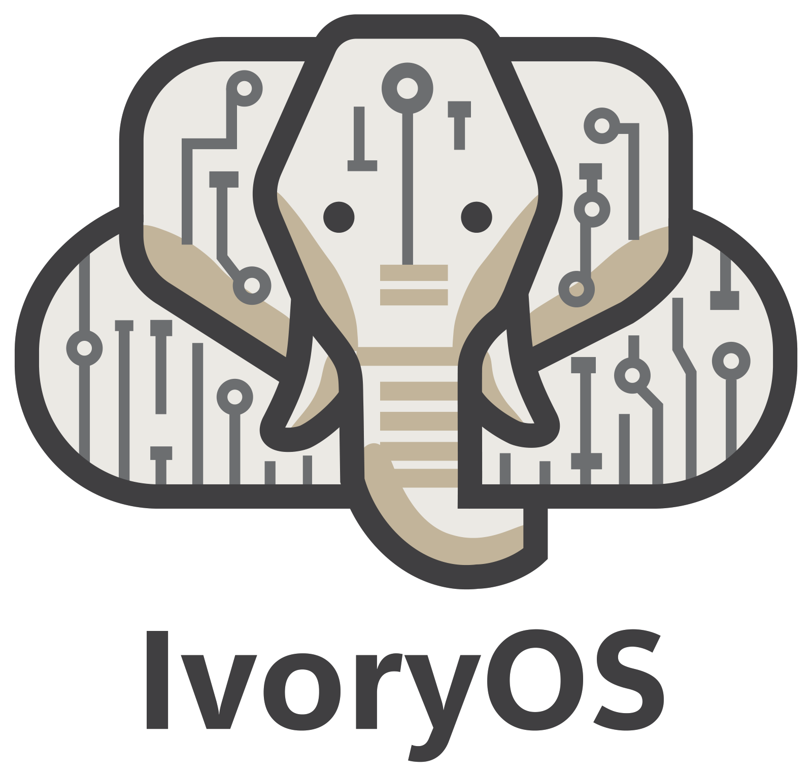

<p align="center">
  <picture>
    <source media="(prefers-color-scheme: dark)" srcset="brand/ivoryos-logo-dark.png">
    
  </picture>
</p>

<p align="center">
  <b>Run your lab's instruments from one place.</b><br>
  Design experiments by drag and drop, run and optimize them, and keep every result.
</p>

<p align="center">
  <a href="https://github.com/ivoryos-ai/ivoryos-next/releases"><b>Download</b></a> ·
  <a href="https://ivoryos-ai.github.io/ivoryos-next/">Documentation</a> ·
  <a href="https://ivoryos.ai">Automation Hub</a> ·
  <a href="https://discord.gg/3KdjhUmsYA">Discord</a>
</p>

---

## What it is

IvoryOS is a desktop app for the computer next to your instruments. Point it at the Python code
that drives them, whether you wrote it, a vendor did, or it came from the Automation Hub, and it
builds the controls itself: every method becomes a step you can drag into a workflow, every
argument a field of the right type. There is no interface to write and no configuration file to
fill in, and it keeps working without an internet connection.

It is for scientists who want to run and automate experiments by pointing and clicking, and for
whoever in the lab writes the drivers: anyone who can write a Python class can bring a new
instrument.

## What you can do

- **Design** a workflow by dragging in your instruments' steps: a prep that runs once, a main part
  that runs for every sample, and a cleanup at the end, with ifs, loops, waits and pauses for a
  person. Values flow from one step to the next. Any workflow can be read, or downloaded, as the
  Python it runs.
- **Run** it once, run it over a spreadsheet of samples, or let an optimizer search for the best
  conditions.
- **Stay in charge.** A failed step pauses and waits for you to retry, skip or stop. A stop holds
  the queue, and the app tells you when a run needs you.
- **Keep everything.** Every run, step and value is kept, searchable, and exportable as CSV.
- **Reuse.** Save workflows to a versioned library, and use one inside another.
- **Install from the Hub.** Drivers, whole platforms and workflow templates shared by the
  community, installed from inside the app.
- **Extend.** Add your own pages and panels as plugins, or let an AI assistant draft workflows
  that you review before anything runs.

IvoryOS Cloud, for watching and running the decks of several labs from one place, is in
development.

## Get started

### 1. Install

Download the installer for your computer from the
[Releases page](https://github.com/ivoryos-ai/ivoryos-next/releases):

| Windows | macOS (Apple silicon) | Linux |
|---|---|---|
| `IvoryOS-Setup-<version>.exe` | `IvoryOS-<version>-arm64.dmg` | `IvoryOS-<version>.AppImage` |

On macOS, open the `.dmg` and drag IvoryOS to Applications. On Linux, make the file executable
(`chmod +x IvoryOS-*.AppImage`) and run it. The first launch downloads Python, so it needs an
internet connection and takes about a minute. The app updates itself after that.

### 2. Try the example

Choose **Try the example** on the welcome page. It sets up a simulated Suzuki coupling screen:
three syringe pumps, a heated reactor, a balance, a UV-Vis probe and an HPLC, all sharing one
reaction model. There is nothing to plug in, and the chemistry responds the way a real screen
would. Build a workflow in the Designer, run it, then let the optimizer find the best temperature
and catalyst loading (add an optimizer under the deck's **Settings** first).

### 3. Bring your own instruments

Choose **Add a deck**. A deck is one set of instruments, with its own workflows and data.

- **From the Automation Hub**: pick drivers, or a whole platform, and the app installs them.
- **A driver you wrote**: any Python class works. Its methods become steps, and their type hints
  become the fields.
  ```python
  class SyringePump:
      def __init__(self, port: str):
          ...

      def dispense(self, volume_ml: float, flow_rate_ml_min: float = 2.0) -> dict:
          """Deliver a volume into the vial."""
          ...
  ```
  `dispense` becomes a step with a required number and an optional one already filled in with
  its default, and the docstring becomes its description. Enums become drop-down lists,
  dataclasses become forms, and whatever a method returns can be saved and used by later steps.
- **A Python script you already have**: choose **From a Python script**, or drop the `.py` file
  on the window. Create your instruments as objects in the script and end it with
  `ivoryos_edge.run(__name__)`:
  ```python
  import ivoryos_edge
  from my_lab import SyringePump

  pump = SyringePump(port="COM3")  # each object becomes an instrument

  ivoryos_edge.run(__name__)
  ```

Each running deck is also a web page, so you can open it in a browser on the same computer. Turn
on **Reachable from other computers on the network** in the deck's Settings to open it from
elsewhere in the lab.

## Help

- **Something wrong?** In the app, **Settings → Help → Report a problem** at any time, or **Send
  to IvoryOS** on a deck's Log tab to include that deck's log. You read everything before it is
  sent, and keys, tokens and your home folder are masked.
- **Questions and ideas**: [Discord](https://discord.gg/3KdjhUmsYA).
- **Bugs and requests**: [GitHub issues](https://github.com/ivoryos-ai/ivoryos-next/issues).
- **Documentation**: [ivoryos-ai.github.io/ivoryos-next](https://ivoryos-ai.github.io/ivoryos-next/)
  covers every page of the app, bringing your instruments, safeguards, plugins and agents. The
  [desktop app guide](docs/desktop_launcher_guide.md) is the short version for decks, ports, logs
  and what to check when something goes wrong.

## For developers

Everything runs from source: [Developing IvoryOS](docs/development.md) covers the edge server,
the web interface, the desktop app, Cloud, the tests and releases, and [AGENTS.md](AGENTS.md)
explains how the pieces fit together and why. More on specific parts:
[plugins](docs/plugins.md), [AI agents and MCP](docs/agent_in_the_loop.md),
[workflow reuse and versioning](docs/workflow_reuse_and_versioning.md), and
[how the optimizers behave](docs/optimizer_behavior.md). Contributions are welcome.

## License

| Part | License |
|---|---|
| Everything except `cloud_frontend/` (edge server, desktop app, frontends, `packages/`, plugin template) | [Apache-2.0](LICENSE) |
| `cloud_frontend/` (IvoryOS Cloud) | [FSL-1.1-ALv2](cloud_frontend/LICENSE.md): use, modify and self-host it; don't offer it as a competing service. Each release becomes Apache-2.0 two years after it is published. |

The IvoryOS name and logo are covered by [TRADEMARKS.md](TRADEMARKS.md), not by the code licenses.
