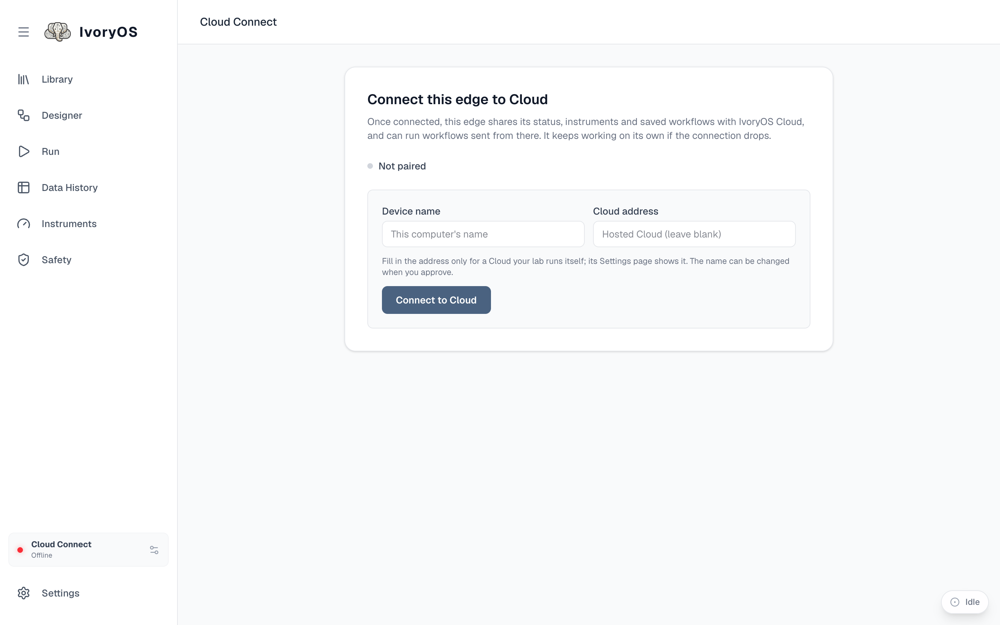

import { Steps } from '@astrojs/starlight/components';

A deck pairs by showing a short code that a signed-in person approves on Cloud. The code is not a
credential, only something to approve; the deck's own secret never leaves it, and nothing typed on
Cloud is sent to a device.

<Steps>

1. On the deck, open **Cloud Connect** (the card at the bottom of the sidebar) and press
   **Connect to Cloud**. Fill in a Cloud address only for a Cloud your lab runs itself. The page
   shows an 8-character code and a link, valid for ten minutes.

2. On Cloud, open **Pair a device** (or follow the link), enter the code, check the device's name
   and instruments, pick its name and workspace, and **Approve**. If the device is not yours,
   **Not mine** denies it.

3. The deck collects its credentials on its own and connects. Its status, instruments and saved
   workflows appear on Cloud's Devices page within seconds.

</Steps>

Signed in, the desktop app does both steps in one click (**Connect** on the deck's Cloud card),
approving the code with the app's own sign-in. From a terminal, `ivoryos-edge pair` does the same.

## What is shared

The deck publishes its status (online, busy), its instrument schema, and its saved workflows.
Which workflows go is the deck's choice: **always** (on connect and on every save) or **manual**
(only when you press **Sync now**). A workflow edited on Cloud can be sent back to the deck, where
it is saved like any local save.

## Pause, resume, remove

- **Pause** keeps the pairing but disconnects; the deck shows as paused on Cloud, and stays off
  Cloud across restarts until you **Resume**.
- **Remove** says goodbye to Cloud, clears what the deck left there, and forgets the pairing. Its
  workflows stay on Cloud as a record of a removed device. Pair it again and it is a new device.

A deck has one lasting id, made the first time it pairs and kept after removal; its name is only a
label, and two decks may share one. Cloud always shows the name.
