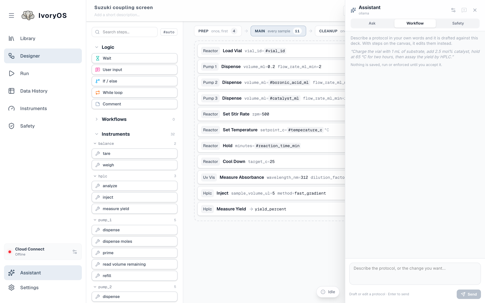

import { Aside } from '@astrojs/starlight/components';

**Assistant** at the bottom of the Designer's toolbox opens a panel where you describe what you
want in a sentence or two, and a language model drafts a workflow out of *this deck's* instruments
and methods.

Every draft is checked before you see it: unknown instruments or methods, missing or mistyped
arguments, values outside a dropdown's choices or a safety limit, `#variables` nothing produces,
unbalanced If/While. The model is told what was wrong and tries again, up to three times, which is
what makes a small local model usable here.

<Aside type="caution" title="Nothing the assistant writes takes effect on its own">
A draft is a **proposal**. It reaches the canvas only when you put it there, it is saved only when
you save, and it runs only when you press Run. The same holds for an outside agent talking to the
deck through its MCP server.
</Aside>

## Models

The gear at the top of the panel chooses the provider, the endpoint, the API key and the model.
The key is kept on the deck's computer (in `agent_settings.json` beside the workflows) and is
never shown again; "saved" beside the field says one is there.

- **Ollama** (default): a model running on this computer. No key, and nothing about your protocol
  leaves the building.
- **An OpenAI-compatible endpoint**: any hosted model with that API. Provider `openai-compatible`,
  the endpoint (`https://api.openai.com/v1` for OpenAI itself), paste the key, then **refresh**
  lists the models the key can use.
- **Claude**, through Anthropic's SDK. Provider `anthropic`; the deck needs
  `pip install 'ivoryos-edge[claude]'`. Paste the key, or leave the field empty if
  `ANTHROPIC_API_KEY` is set in the environment the deck runs in.

Setting them up, using Claude Desktop or Claude Code as the agent instead, and what the validator
checks, is in [Agents and MCP](/dev/extend/agents-and-mcp/).
