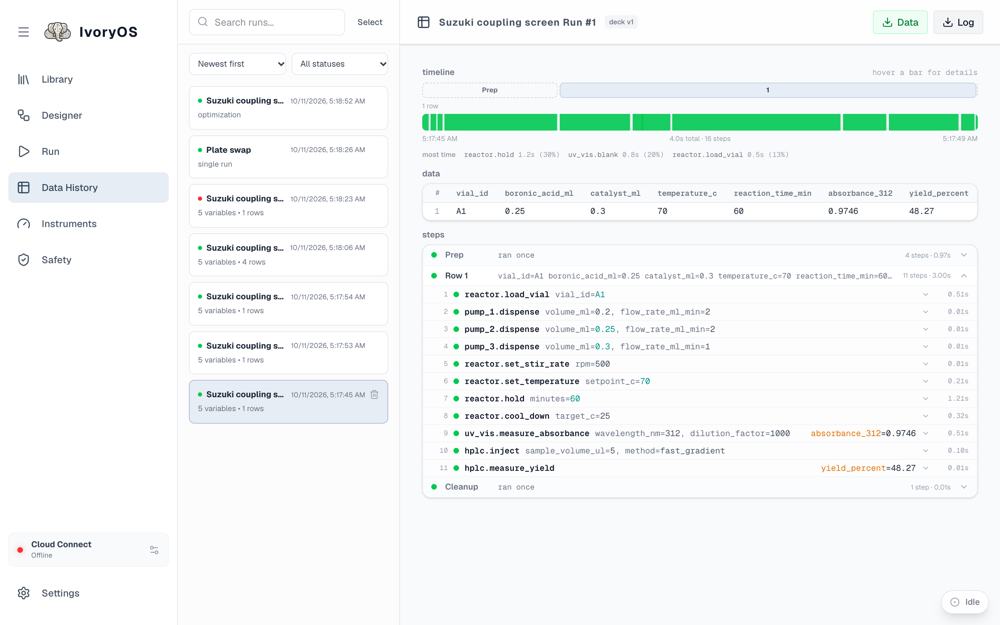

Data History keeps every run the deck has made. The list on the left is searchable (by name, by a
value, by an instrument or method), sortable, and filterable by status; selecting a run opens it.

## Reading a run

| Section | What it shows |
|---|---|
| **Header** | the run's name, the deck version it ran on, and the two exports |
| **Timeline** | one bar per step, to scale, with the slowest steps named. Prep, each row or trial, and Cleanup are marked above it; hover a bar for its details. |
| **Data** | one row per sample or trial: every value it was given (a column per `#variable`) and every value a step saved (a column per output). An optimization shows its suggested values and objectives. |
| **Steps** | Prep, then each row or trial, then Cleanup, each opening to the step list: instrument, method, the arguments as sent (values that came from a `#variable` are coloured), the result, the duration, and the error for a failed step. |
| **Configuration** | for an optimization: the engine, budget, strategy, search space and objectives |
| **Optimizer plots** | for an optimization: the backend's own plots (feature importance, contours, parallel coordinates). Kept in memory for the most recent optimization since the deck started; an older run says so. |

Status colours mean one thing throughout: green completed, amber *completed with issues* (a step
failed and was skipped, a retry), grey hollow ring *not run* (a row or cleanup the run never
reached after a stop), red error.

## Exports

- **Data** is a CSV of the data table: one row per sample or trial, one column per input and per
  saved output.
- **Log** is a CSV of every step with its arguments, result, status and times.

## Deleting

The trash on a card deletes one run. **Select** puts a box on every card for deleting several,
with select-all; a run that is still going is refused and the rest are deleted.
