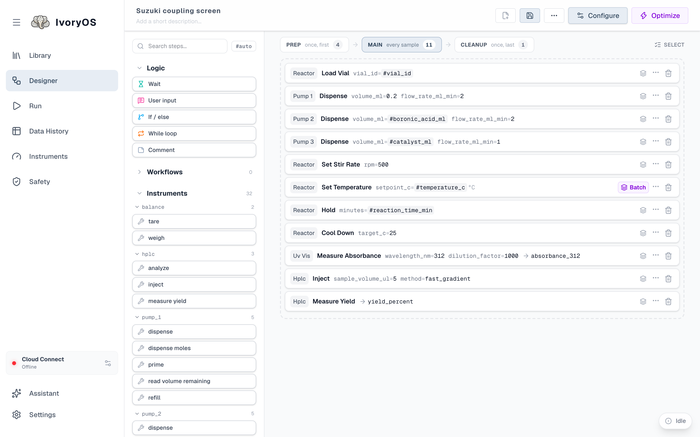
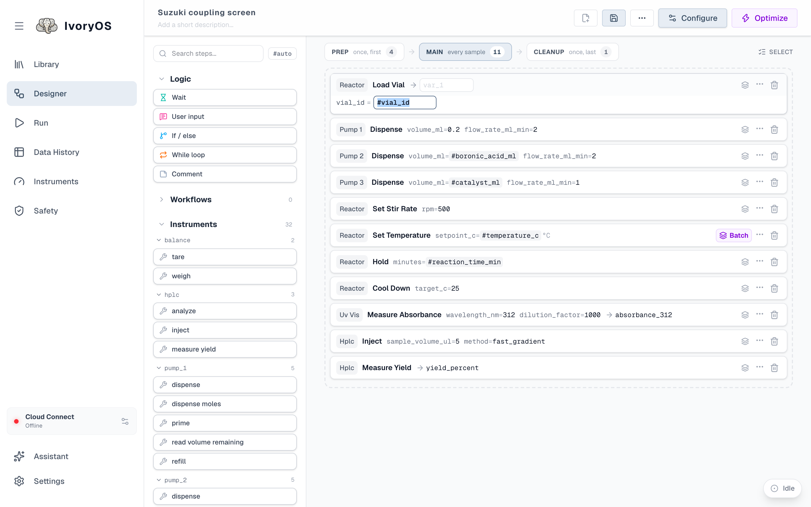
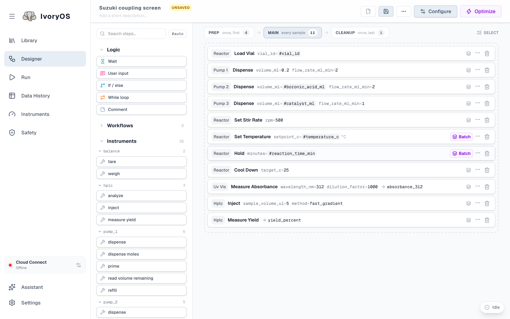
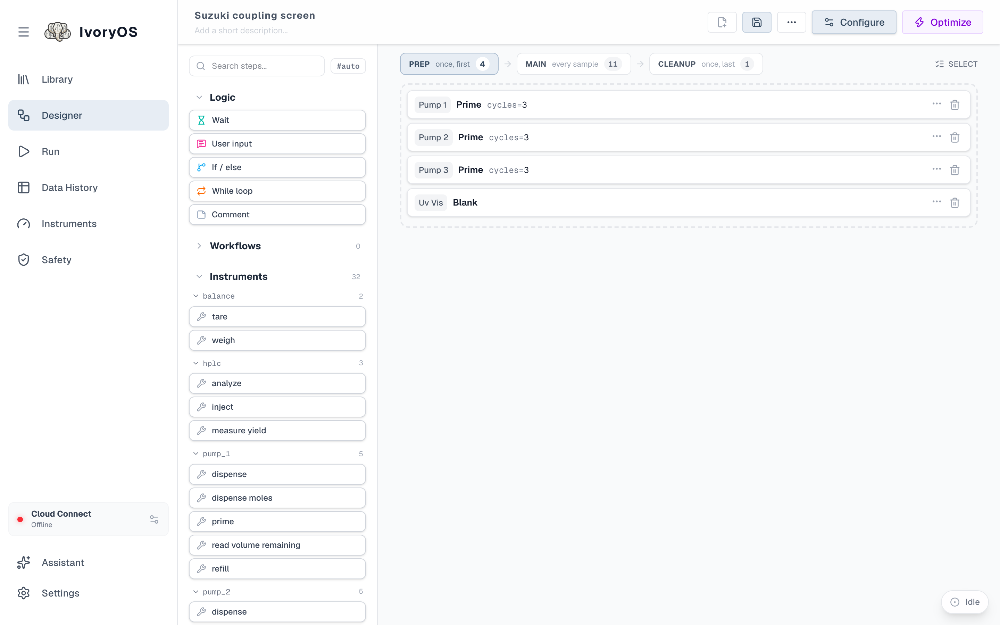
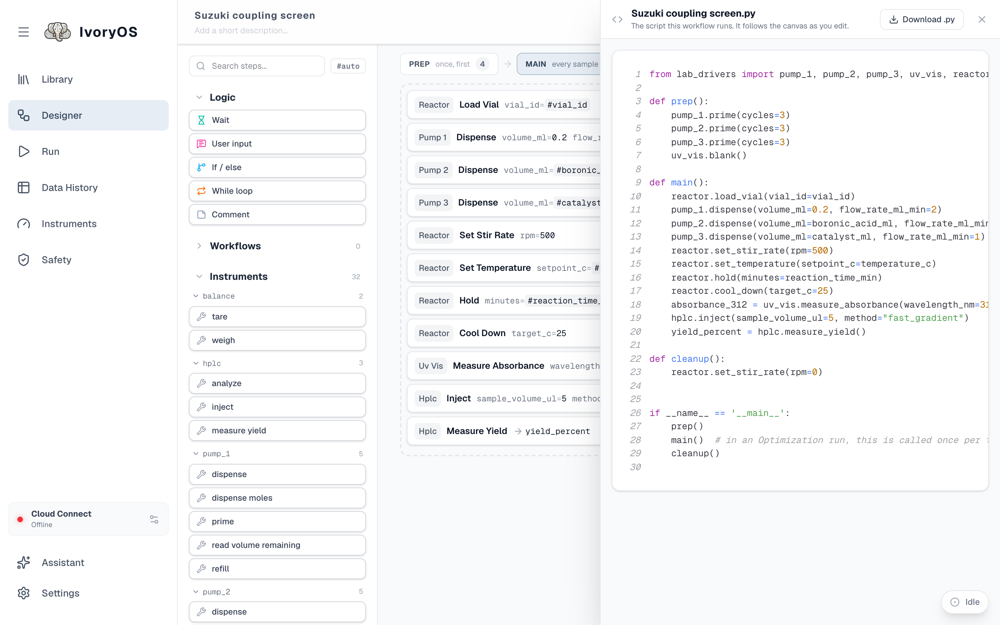

import { Steps, Aside } from '@astrojs/starlight/components';

The Designer is where a workflow is built. The toolbox on the left lists everything the deck can
do; the canvas is the workflow, in three phases chosen by the tabs above it: **Prep** runs once
first, **Main** runs for every sample or trial, **Cleanup** runs once last.

## The parts

| | |
|---|---|
| **Name and description** | Top left. The name is how the workflow is saved and found; a workflow with no name asks for one when you save. |
| **New, Save, ⋯** | New starts an empty workflow (it asks first if the canvas has steps). Save writes a new version to the Library. The ⋯ menu holds the rest: View as Python opens the script the workflow runs in a drawer beside the canvas (Download .py is in the drawer), and Export or Import move the workflow as a JSON file. |
| **Run / Configure / Optimize** | Run starts the workflow as it is. When it has open values (`#variables`) the button reads **Configure** and opens the Run page instead, and **Optimize** opens the Optimize tab. While another run is going the button reads **Add to Queue**. |
| **Toolbox** | Search box, the `#auto` switch, then three groups: **Logic** (built-in steps), **Workflows** (saved workflows, as a copy or a link) and **Instruments** (every method of every instrument, foldable per instrument). |
| **Prep → Main → Cleanup** | The tabs above the canvas, in run order, each with its step count. Prep runs once before Main, Cleanup once after, even when Main is iterated or optimized. The canvas shows the chosen phase. |
| **Canvas** | The chosen phase's steps. Each step is one line that reads like its call. |
| **Assistant** | Bottom of the toolbox: describe a protocol in words and have it drafted against this deck. See [Assistant](/guide/assistant/). |
| **Unsaved** | A badge beside the name whenever the canvas differs from the saved version. Loading another workflow asks before discarding it. |

## Build a workflow

<Steps>

1. **Drag a step** from the toolbox onto the canvas, or between two steps. Each instrument
   method is one step; the built-in steps under *Logic* are explained below.

2. **Fill in its arguments.** A dropped step opens ready to fill in. Folded, a step shows every
   argument on one line: a typed value in black, a default in grey, a `#variable` in indigo, and
   a required value still missing as an amber `?`. Click any of them to open the step; click
   outside it or press <kbd>Esc</kbd> to close.

   

3. **Leave a value open with `#`.** Type `#temperature_c` instead of a number and that argument
   becomes an input the Run page asks for: a field on Once, a column on Iterate, a dimension on
   Optimize. Any name works; the same name in two steps means the same value. The `#auto` switch
   makes every dropped step do this for all its fields.

4. **Save what a step returns.** Each step has an output field after the arrow (`→ var_1`). Type a
   name and the result is saved under it; a method that returns an object with several fields
   offers one output per field. A later step reads it back by typing `#name` in an argument. The
   editor suggests the names saved by the steps *before* the one you are editing.

5. **Reorder, duplicate, disable, delete.** Drag a step by its handle. The `⋯` menu duplicates it
   (an If or While construct duplicates whole) or disables it (it stays, greyed, and does not run).
   The trash deletes it.

6. **Mark a step as once per batch.** The layers icon on each Main step switches it between *per
   sample* (default) and *per batch*, which matters when the workflow is iterated over a
   spreadsheet: see [Iterate](/run/iterate/#per-sample-and-per-batch-steps). Purple always means
   "once per batch".

   

7. **Add Prep and Cleanup.** Click the **Prep** or **Cleanup** tab and drop steps into its list.
   Priming pumps and blanking a spectrometer belong in Prep; parking the stirrer in Cleanup. To
   move a step to another phase, drag it over that phase's tab and hold: the canvas switches to
   that phase and you drop the step where it belongs. Let go on the tab itself and the step goes
   to the end of that phase.

   

8. **Save.** The first save asks for a name; every later save adds a version to the Library and
   keeps the old ones. If other workflows link to this one, the Designer says so before saving and
   offers to save under a different name instead.

</Steps>

<Aside type="tip" title="Read it as Python">
**View as Python**, in the ⋯ menu at the top, opens a drawer beside the canvas with the workflow
as the script it runs, and follows the canvas as you edit. The script has prep, main and cleanup
as functions, saved outputs as variables and linked workflows as functions of their own. It is the
quickest way to check what a workflow means; Download .py in the drawer's header saves it.

</Aside>

## Logic steps

| Step | What it does | Fields |
|---|---|---|
| **Wait** | Pauses for a number of seconds. Stop ends it at once. | `duration_seconds` |
| **User input** | Pauses the run and shows a message on every page. With a *variable name* it also asks for a value (text, integer, decimal or yes/no) and saves it under that name; without one it is a plain pause with a **Continue** button. | `prompt`, `variable_name` (optional), `input_type` |
| **Set variable** | Saves a value under a name, read as `name = value`: a number, `True`/`False`, `"text"`, or a calculation over the names saved so far (`volume * 2`, `i + 1`, `round(mass / 3, 2)`). Later steps use it as `#name`. The type converts the result; *auto* keeps it as it is, and with *str* the value is text, where `#name` is filled in. | `variable_name`, `value`, `type` |
| **If / else** | Runs the steps between **If** and **Else** when the condition holds, the ones between **Else** and **End_If** otherwise. Dropping it adds all three; drag steps between them. | `condition` |
| **While loop** | Repeats the steps between **While** and **End_While** as long as the condition holds. | `condition` |
| **Comment** | Writes a note into the run log, like `print()`. | `message` |

A **condition**, and a Set variable's calculation, is a Python expression over the names saved so
far, written without the `#`: `absorbance_312 > 1.5`, `yield_percent < 40 and attempt < 3`. A Set
variable whose value is a lone `#name` instead takes that value from the spreadsheet or the
optimizer, like any step's argument. A message or prompt may contain
`#name` anywhere in its text (`"flow rate is #flow_rate"`), and the value is filled in when the
step runs.

## Reuse a saved workflow

The **Workflows** group lists every saved workflow except the one being edited, with a
**Copy / Link** switch above it.

- **Copy** (the default) drops the workflow's steps onto the canvas as a group. They are yours to
  edit, and nothing ties them to the saved workflow any more.
- **Link** drops one step, *Library Workflows · name*, pinned to the saved workflow's current
  version. Click it to read its steps in a side drawer with your values filled in. When the saved
  workflow is edited, the link keeps running the version it was pinned to until you update it;
  **Detach** turns it into a copy.

A linked workflow used as a step runs its **Main** steps only. Its own Prep and Cleanup run when
it is the whole run: on its own, or as a stage of a design (see [Stages](/run/stages/)).

**Groups** are for tidiness: tick the boxes on several consecutive steps (the *Select* control
above the canvas) and group them, and they collapse, move and delete together. A group is not a
link; it tracks nothing.

## When a step is wrong

Warnings appear above the step, never behind a click: a method the deck no longer has, a missing
required value, text in a number field, a value outside a safety limit. The Library's
*working first* sort uses the same checks, so a workflow saved for an older driver points you at
exactly the steps to fix.
