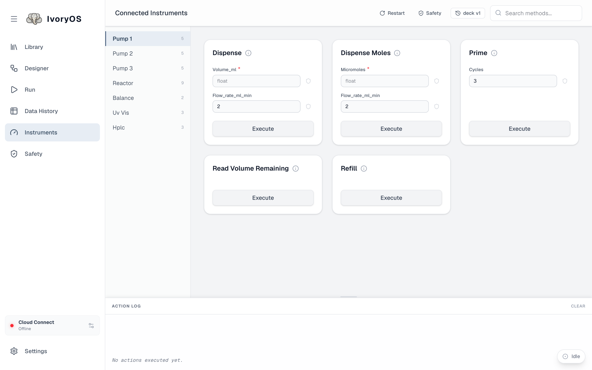
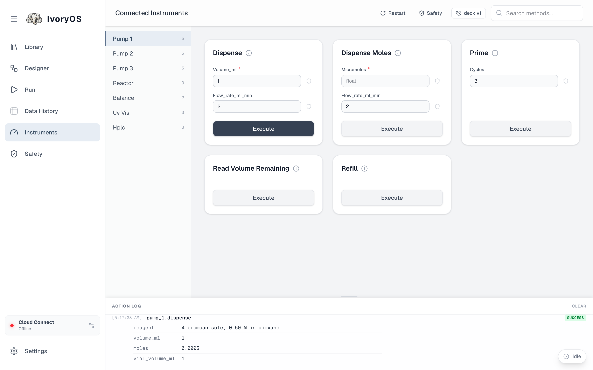

import { Aside } from '@astrojs/starlight/components';

The Instruments page is the deck as the drivers describe it: one entry per instrument, one form
per method. It is where you test a new driver, drive something by hand between runs, and see what
did not load.

## Run a method by hand

1. Pick an instrument on the left (the number is how many methods it has).
2. Find the method; the search box filters by name.
3. Fill in its fields (required ones are marked `*`; dropdowns, True/False and nested forms
   follow the driver's type hints) and click **Execute**.
4. The **Action log** at the bottom shows each call and what it returned, or the error it raised.

<Aside type="caution" title="While a run is going">
Executing a method here bypasses the queue and drives the hardware immediately, even in the middle
of a run. The page asks you to confirm when a run is active. Prefer **Pause** on the run bar
first.
</Aside>

## Set a limit from here

The shield at the end of each field opens the same limit editor the Safety page uses, for that one
field: a minimum and maximum, a list of allowed values, a tray, or just a unit. Saved there, it is
checked before every run and every call. See [Safety](/guide/safety/).

## Not loaded

An instrument whose driver failed to import, whose constructor raised, or whose setup call failed
is listed under **Not loaded** with the full error, and the rest of the deck runs without it. Fix
the cause (plug it in, correct the port, install the package) and **Restart**.

## Restart and deck versions

**Restart** starts the deck process again: it re-reads the deck file, re-imports the drivers (so an
edited driver takes effect) and reconnects every instrument. It is refused while a run is going
unless you confirm.

The **deck v*N*** badge is the deck's current shape. Click it for the history: every time the
instruments or their methods changed (a driver update, an instrument added), with what was added,
removed or retyped. Every run and every saved workflow version is stamped with the deck version it
belongs to.
