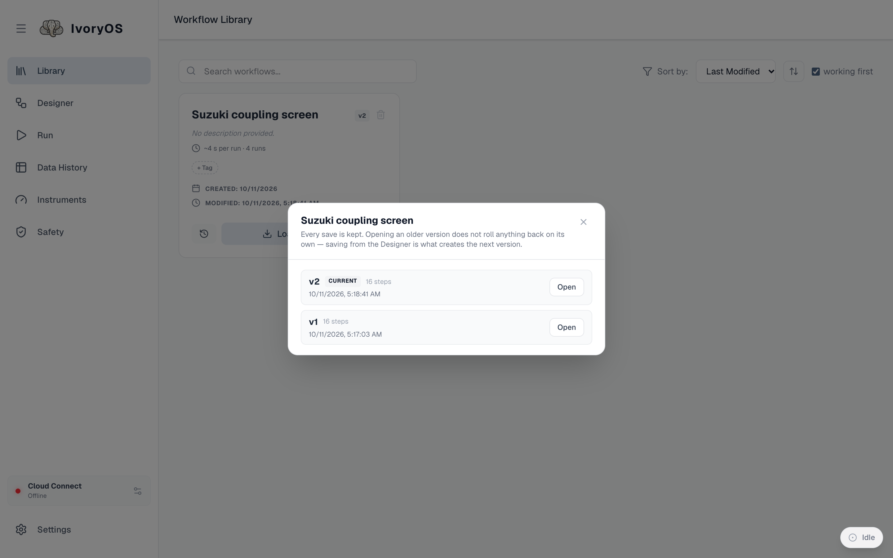
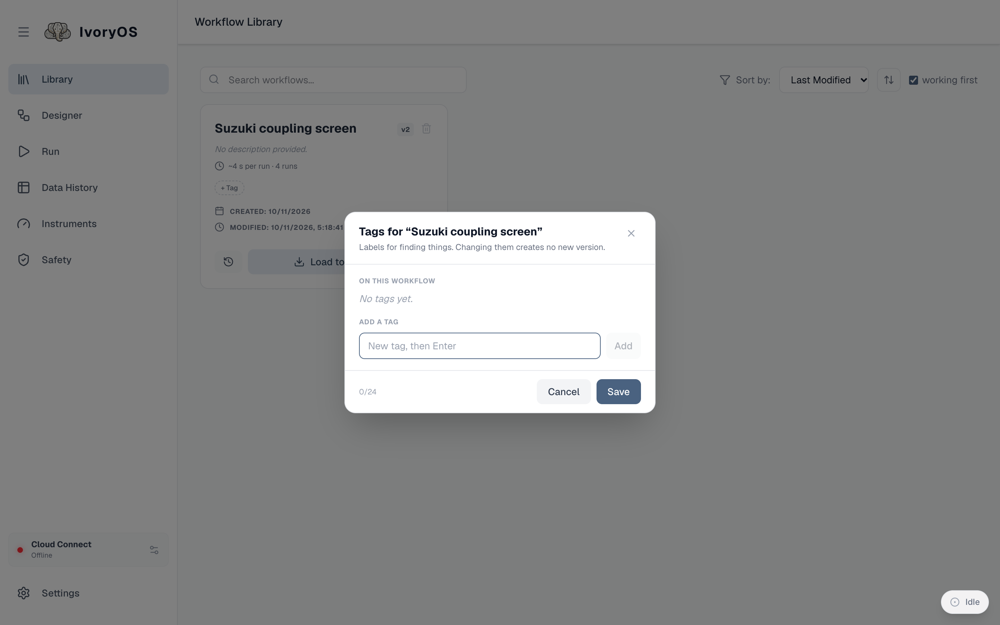

import { Aside } from '@astrojs/starlight/components';

The Library lists every workflow saved on this deck.

Each card shows the name and current version, the description, how long a run typically takes
(a median over completed runs, once there are some), its tags, when it was created and last
modified, and three actions: **version history** (the clock), **Load to Designer**, and delete.
The search box, the sort order and the *working first* box are at the top.

## Load, edit, save again

**Load to Designer** puts the workflow on the canvas. If the canvas holds unsaved changes, you are
asked first. Edit it there and **Save**: the Library card moves to the next version. A workflow is
never overwritten; every save is kept.

## Versions

The clock icon opens the version history: every save, with its date and step count, and an
**Open** button that loads that version into the Designer. Opening an older version rolls nothing
back on its own; saving from the Designer is what creates the next version, so "going back" is
*open v2, save*.

A version also records the **deck version** it was written on, so a workflow from before a driver
update says so.

## Tags

**+ Tag** on a card adds free-form tags (`screening`, `calibration`); the tag chips above the list
filter by them. A workflow can carry several, which is why tags rather than folders: a protocol is
both a screen and a calibration, and its name is its identity everywhere (on disk, in Cloud, in
every link to it), so there is nothing to move. Tags are matched ignoring case.

## Which workflows still run here

Every workflow is checked against the deck's current instruments. One that names a method the
deck no longer has, or an argument that no longer exists, carries a badge and sorts after the
working ones when *working first* is ticked. Load it: the Designer marks exactly the steps that
need fixing.

<Aside type="note" title="Links and deletion">
A workflow that other workflows **link** to (see [the Designer](/guide/designer/#reuse-a-saved-workflow))
cannot be deleted while they do, and saving a change to it warns you that they will change too.
A workflow that was only ever **copied** has no such ties.
</Aside>
