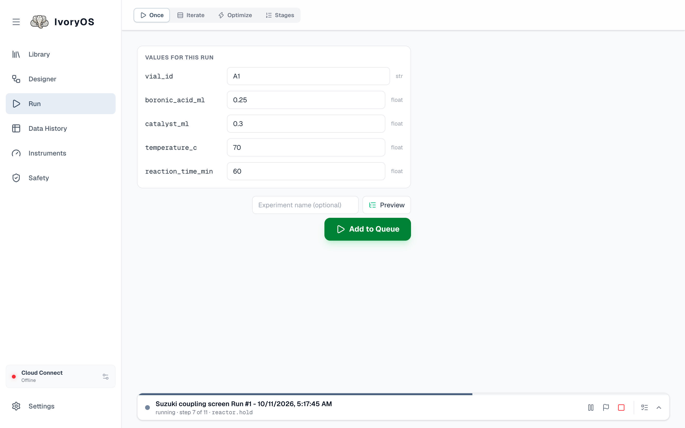
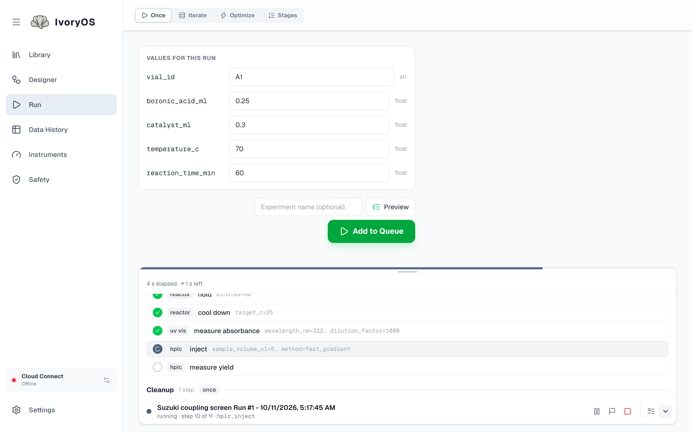
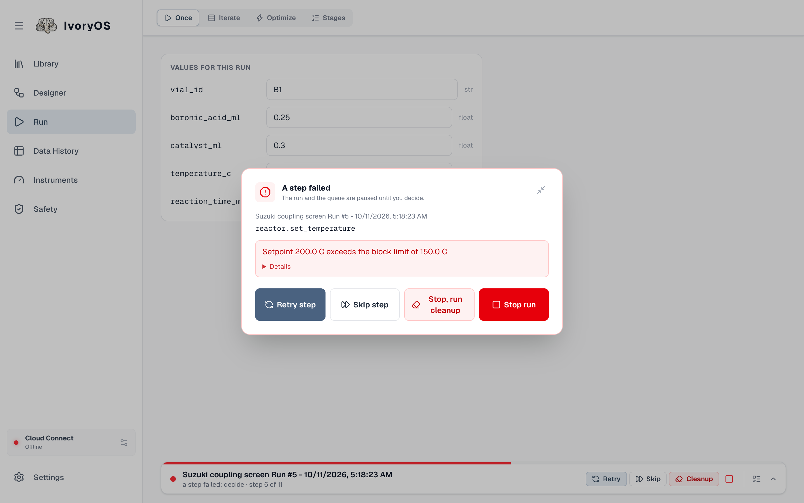
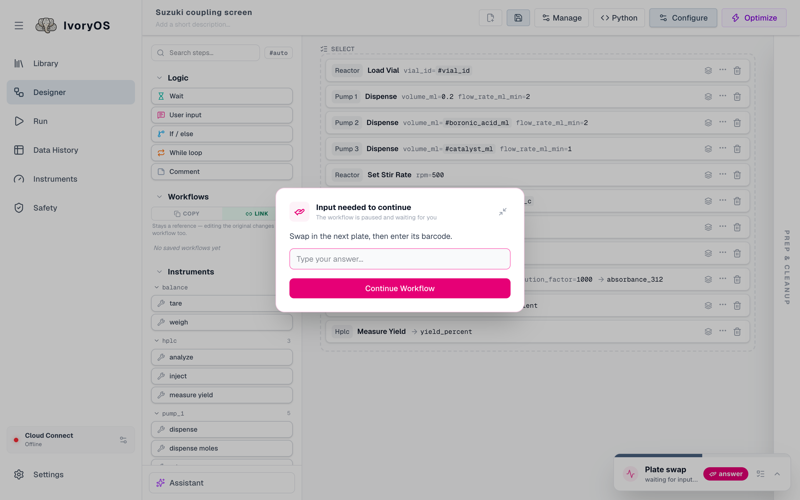
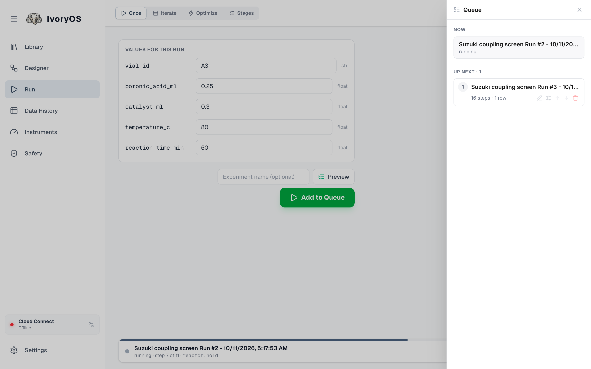

import { Aside } from '@astrojs/starlight/components';

A run is watched where it was started. The chip at the bottom of the Run page reads **Idle**,
**N queued** or **Queue paused**; when a run starts it widens into the **run bar**, and shrinks
back when the run is over. On every other page a small floating card shows the same thing.

## The run bar

Left to right: the run's name and what it is doing (*running · step 7 of 11 · reactor.hold*), then
the controls:

| Control | What it does |
|---|---|
| **Preview** | every step and every call this run will make |
| **Pause** | pause after the current step; the same button resumes |
| **Stop after this iteration** (the flag) | a *graceful stop*: finish the row, batch or trial the run is on, then stop. It asks whether to run the cleanup steps and whether the queued runs should go on. |
| **Stop now** (the square) | stop at once. Cleanup does not run, and the queue stays held until you resume it. |
| **Queue** | opens the queue drawer |
| **Show the steps** | opens the step list above the bar |

The progress strip along the top of the bar is the run's only progress bar. Opened, the steps live
in a box you can drag taller or shorter; it follows the running step unless you scroll it
yourself. Steps still to come can be edited from here (the pencil) before the run reaches them.

## When the run needs you

**A step failed.** The run and the queue pause, and a pop-up appears on whichever page you are on:
the step, the error, and the choices. **Change values and retry** edits the step's arguments
first. **Retry step** runs it again, **Skip step** goes on without it, **Stop, run cleanup** ends
the run after its cleanup steps (offered when there is a cleanup still ahead), **Stop run** ends it
at once with no cleanup, since a failure may have left the deck in a state cleanup should not walk
into. Nothing is retried or skipped on its own. The error and what you chose stay with the run.

**A User input step.** The prompt appears the same way, with a field for the answer when the step
saves one, or just **Continue** for a pause.

**The optimizer** cannot suggest, or refuses a round's results: same pop-up, with its own choices
(*Ask again*, *Record again*, *Go on without it*). See [Optimize](/run/optimize/).

<Aside type="tip" title="Away from the screen">
In the desktop app these moments become system notifications, with sound for what needs you, and
the Dock or taskbar icon bounces until you look. In a browser, the page asks once whether it may
notify you while its tab is in the background. See
[Settings and notifications](/guide/settings-and-notifications/).
</Aside>

## The queue

Runs execute one at a time. Starting a run while one is going (**Add to Queue**) puts it behind.
Open the drawer from the chip or the bar's Queue button:

- **Now** is the running run; **Up next** is what waits, in order, with its size in its own unit
  (steps and rows, or iterations for an optimization).
- The pencil renames a queued run; the sliders open its page again with its values, where **Save
  changes** replaces it in the queue; the arrows move it sooner or later; the trash removes it.
- **Resume queue** appears whenever the queue is held, which happens after **Stop now**, after a
  failed run was stopped, and after a graceful stop told to hold. Nothing waiting starts until you
  press it, though a new run you submit while nothing else waits starts anyway.
