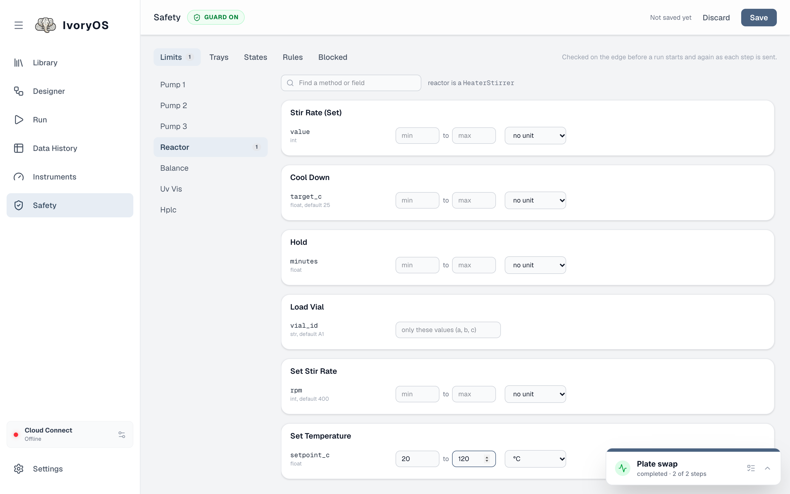
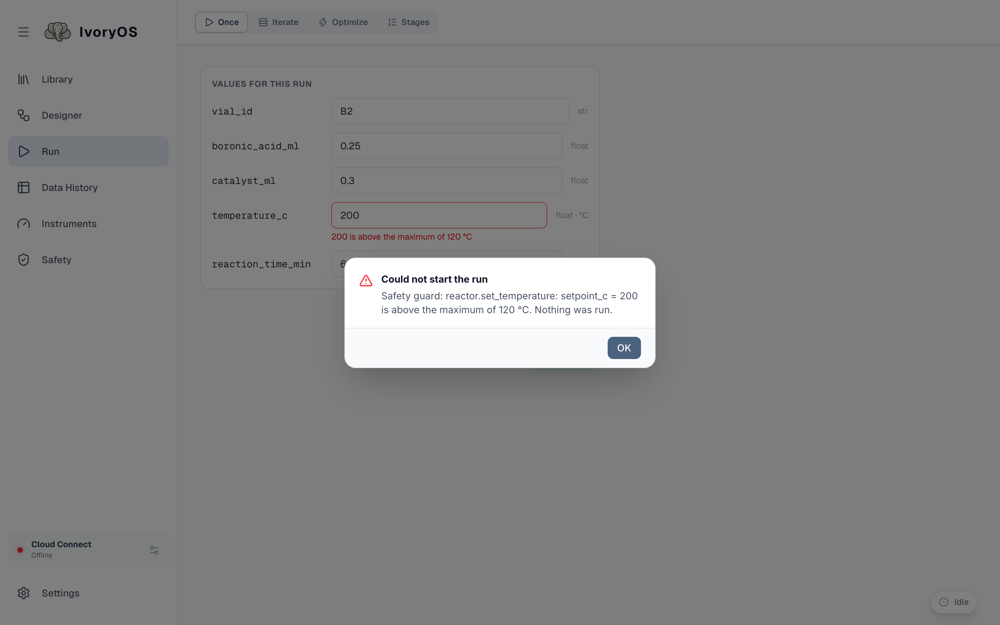
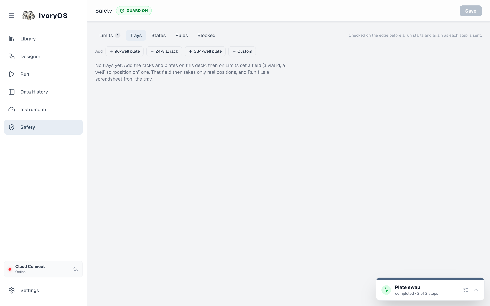
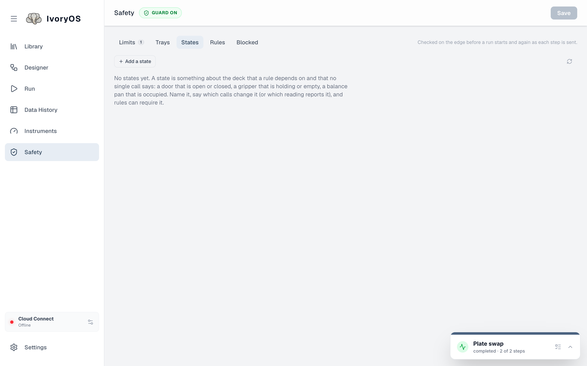
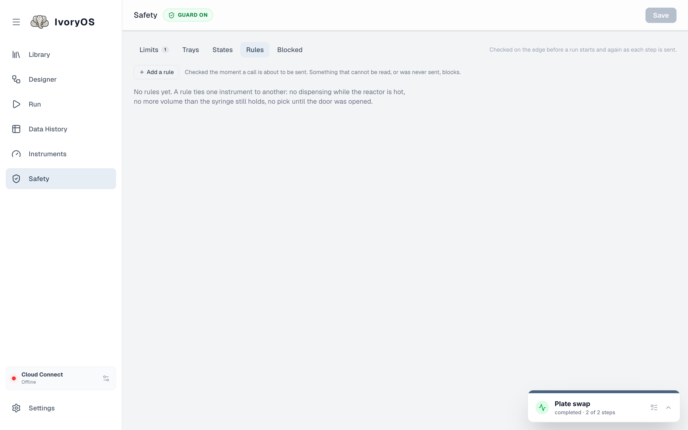

import { Steps, Aside } from '@astrojs/starlight/components';

A driver says what an instrument *can* do. What a bench *allows* is the lab's decision, so it is
configured on the Safety page, outside the drivers, and survives a driver update. Everything here
is checked twice: when a run is submitted (literal values, an optimization's whole search range)
and again immediately before each call is sent (every value, after `#variables` are filled in).

## Limits

A limit is per field: pick an instrument, find the method, and set a **minimum and maximum**, a
list of **allowed values**, or **a position on a tray**. The dropdown beside it gives the field a
**unit** (µL, mL, °C, rpm, min, … or your own), which the Designer, the Run tabs and Data History
then show everywhere that value appears. A unit alone, with no bounds, is a valid limit.

<Steps>

1. Open **Safety**, choose the instrument (the row of buttons), and find the field.

2. Type the bounds and pick a unit. A field typed as a list of choices in the driver already
   accepts only those; a limit can only narrow it.

3. **Save**. The Once form now marks a value outside the limit as you type it, and Run refuses
   the run before anything moves.

   

</Steps>

A limit can target an instrument, or every instrument built from one driver class. An argument the
step leaves at its default is checked at that default, so a 1 mL/min limit catches a step that
never typed a flow rate.

<Aside type="note" title="A refused step is a failed step">
During a run, a value the guard refuses pauses the run exactly like a driver error: the pop-up names
the limit, and you retry with other values, skip, or stop. Nothing is ever clamped silently.
</Aside>

## Trays

A tray is rows × columns with a naming scheme (`A1`, `A01`, `1`, …) and any blocked positions. A
field limited to a tray takes only its positions, exactly as named, and gets a picker on the Run
tabs. A liquid handler's labware shows up here on its own, from the driver's worktable.

## States and rules

**States** describe the deck's condition in the lab's own words (`balance_door`: open or
closed), because no two drivers agree on theirs. A state is either **read** from an instrument each
time it is needed, or **set by** the calls that change it (`balance.open_door` leaves it open),
remembered across restarts, and settled by hand on the States tab when unknown.

**Rules** are interlocks: *when* a call matches, *require* that clauses hold, comparing an argument
of the call, a reading from an instrument, a state, or the last value sent through this deck. The
Rules tab builds them without typing code.

Anything that cannot be determined **blocks**: a reading that fails, a state nothing has set yet.

**Blocked** lists what the guard refused recently and why.

The file behind all of this (`safety.json` in the deck's data folder) and how to write it by hand
are in [Safeguards](/dev/extend/safeguards/).
