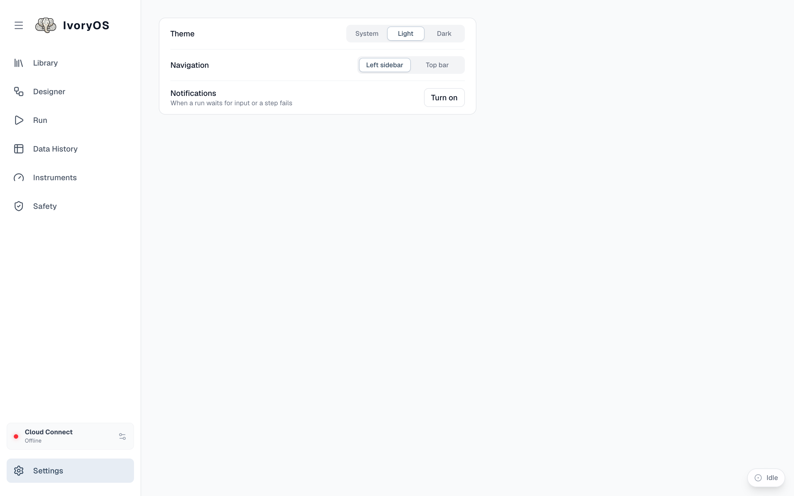

## In a browser

**Settings** at the bottom of the sidebar has three things, all stored in that browser:

- **Theme**: System, Light or Dark.
- **Navigation**: the sidebar on the left, or a top bar.
- **Notifications**: whether this page may notify you while its tab is in the background, when a
  run waits for input or a step fails. The page asks once the first time a run is under way.

## In the desktop app

The deck's Settings gear is hidden: theme and layout follow the app (the launcher's **Settings →
Appearance**), and the app does the notifying for every running deck, whether or not its tab is
open:

| Group | Announces | Default |
|---|---|---|
| **Needs you** | a step waiting for input, a failed step, a deck that stopped unexpectedly | on, with sound |
| **When a run ends** | a run that finished (only runs longer than a threshold, 5 min by default); a run that stopped or ended in error | finished on, stopped off |
| **Heads up** | a deck you started is ready or could not start; an install finished or failed | on, only while you are in another app |

Each deck can be muted. Nothing about a deck is announced while its tab is the one you are looking
at, since its own pop-up or run bar already says it. If the system refuses the app's notifications
(macOS does for an unsigned build), Settings says so and offers a test and a link to the system's
notification settings; the Dock bounce or flashing taskbar button works regardless.
