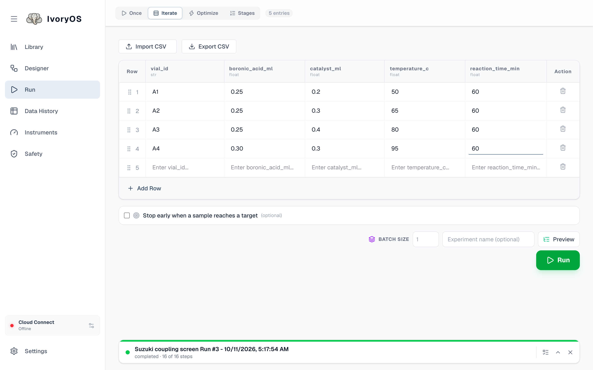
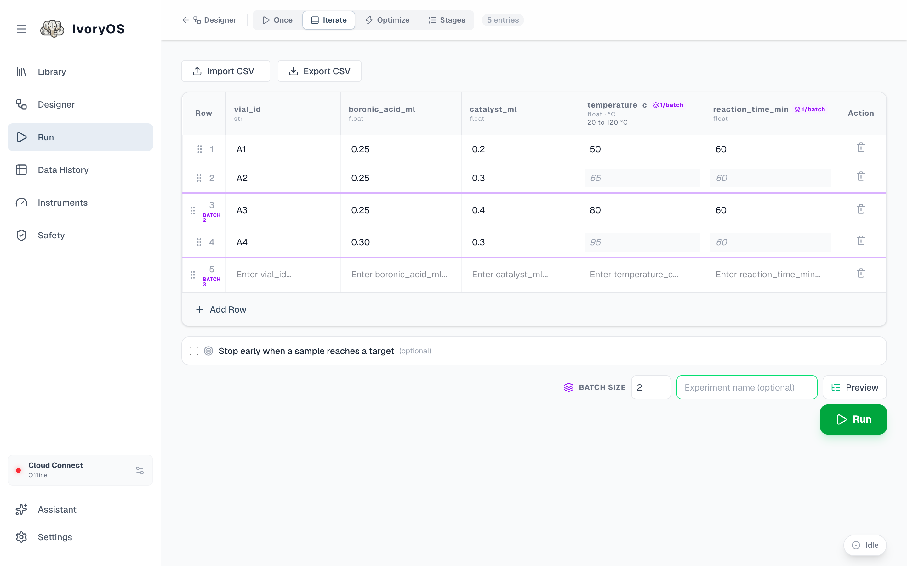

import { Steps, Aside } from '@astrojs/starlight/components';

**Iterate** runs the workflow once per row of a spreadsheet: one column per open value, one row
per sample.

<Steps>

1. Open **Run → Iterate**. The table has a column for every `#variable` in the workflow, typed
   from the step that uses it. Five empty rows are there to start with.

2. Fill in the rows. **Add Row** adds one; the handle on the left drags rows into order; the trash
   deletes one. **Import CSV** fills the table from a file whose header matches the column names,
   and **Export CSV** saves it. Blank rows are skipped.

   A column that holds a position on a tray or a well on a plate gets a picker: pick the positions
   in visiting order and the column fills one row each.

3. Set **Batch size** if the workflow has steps marked *once per batch* (see below). Blank means
   one: each row runs start to finish before the next.

4. Optionally tick **Stop early when a sample reaches a target** and name a saved output, a
   comparison and a threshold. When a sample meets it, the run ends after that sample, cleanup
   included, as a success; the rows left are marked *not run*.

5. **Preview**, then **Run**. Data History shows one row per sample with every value it was given
   and everything it saved.

</Steps>

## Per-sample and per-batch steps

In the Designer, each Main step has a switch between **per sample** (the default) and **once per
batch** (purple). Iterate walks the rows in groups of *Batch size*, and within a group runs the
workflow step by step: a per-sample step runs once for each row in the group; a batch step runs
once for the whole group.

The common case: a heater holds four vials at the same temperature. `set_temperature` is marked
*once per batch*, batch size is 4, and the temperature column is read from the **first row of each
group only**. The table shows this: the column header carries a *1/batch* badge, a purple line
marks where each group starts, and the rows that are not used for that column are greyed out.

Groups are cut by row position (rows 1–4, 5–8, …), never by which rows have data, so the
boundaries are visible before you type anything. A batch step's result goes back to every row of
its group when the step was given one value per row (a plate read keyed by well); otherwise it
shows under the group's first row.

<Aside type="note" title="If and While in a spreadsheet run">
An If or While construct is one unit of the walk: a per-sample construct runs through for each row
in turn, and reads that row's own saved values, so `If absorbance_312 > 1.5` decides on that
sample's measurement.
</Aside>
