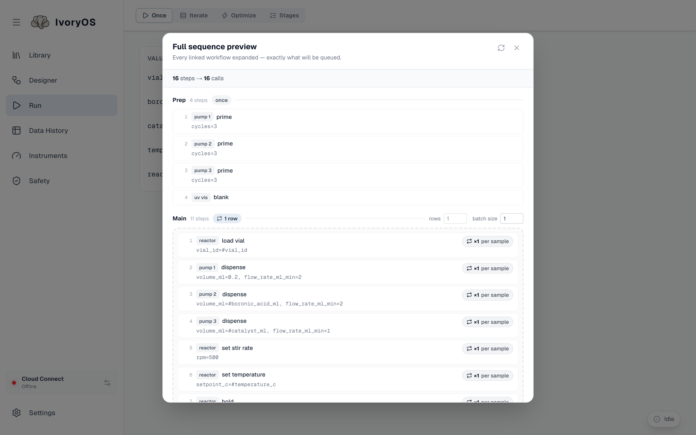

import { Steps } from '@astrojs/starlight/components';

The **Run** page has four tabs: **Once**, **Iterate**, **Optimize** and **Stages**. They all run
the workflow currently on the Designer canvas, and differ only in how its open values
(`#variables`) are supplied. **Once** asks for each value one time and runs the workflow one time.

<Steps>

1. Open **Run** (or **Configure** in the Designer). One field per open value, with its type
   beside it. A workflow with no open values says *Nothing to fill in* and runs as it is.

2. Fill in the values. A field that has a safety limit or a unit shows it; a value outside the
   limit is marked at once and refused when you press Run.

3. Name the run, or leave it blank for a numbered name (`<workflow> Run #3`).

4. **Preview** shows every step the deck will make, in order, with your values substituted and any
   linked workflow expanded, exactly as the deck will run it.

   

5. **Run.** If another run is going, the button reads **Add to Queue** and asks before queueing.
   The run bar at the bottom of the page follows the run; see
   [The live run and the queue](/guide/live-run-and-queue/).

</Steps>

A linked workflow inside the design runs its Main steps only here; its Prep and Cleanup run when it
is the whole run (on its own, or as a [stage](/run/stages/)).
