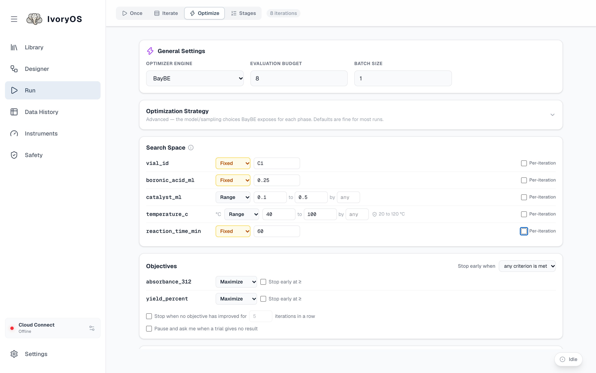
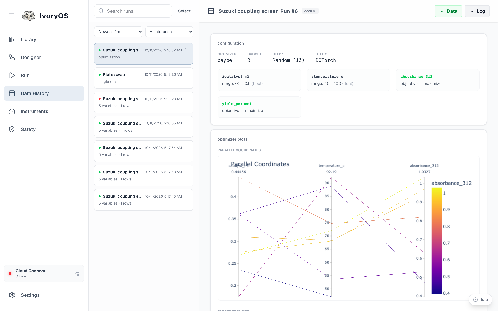

import { Steps, Aside } from '@astrojs/starlight/components';

**Optimize** hands the workflow's open values to an optimizer. Each trial, the optimizer suggests
values, the workflow runs with them, and what it measured is reported back; after the budget is
spent, the best trial is in Data History.

<Aside type="note" title="An optimizer must be installed on the deck">
The engine dropdown lists the backends the deck has: **Ax**, **BayBE** and **NIMO**. In the
desktop app, add one under the deck's **Settings → Optimizers**. If a backend is installed but
missing from the list it failed to load, and the deck's log says why at startup.
</Aside>

<Steps>

1. **General settings.** Pick the engine, the **evaluation budget** (the total number of trials)
   and the **batch size** (how many trials the optimizer suggests at once; every trial in a round
   runs, then the round is reported back together).

2. **Search space.** One row per open variable. Each is either **Range** (`min` to `max`, with an
   optional step, which makes a grid), **Choice** (a list of values), **Substance** (a SMILES per
   name; BayBE with its chemistry extra), or **Fixed** (one value for the whole run, which takes
   that variable out of the search). **Per-iteration** instead gives it a table of values, one per
   trial, for something that must differ by trial but is not searched: a vial position.

3. **Objectives.** Every numeric output the workflow saves is listed; set each to **Maximize** or
   **Minimize**. Optionally stop early when an objective reaches a value, when no objective has
   improved for *N* trials in a row, and tick **Pause and ask me when a trial gives no result** to
   be asked rather than have such a trial left out.

4. **Existing data** (optional) warm-starts the optimizer with results it has not run itself:
   earlier runs from Data History whose search space and objectives match, or a CSV with those
   columns.

5. **Optimization strategy** (advanced) sets the random start and the model, and
   **Constraints** add relations the suggestions must satisfy (`catalyst_ml + ligand_ml <= 0.6`),
   checked before the run is accepted.

6. **Start Optimization.** The run bar reports *trial 3 of 8*; Data History shows the
   configuration, one row per trial with its suggested values and objectives, and the optimizer's
   own plots for the most recent optimization since the deck started.

</Steps>

## What the three backends do differently

They count the random start differently, treat a failed trial differently, and use existing data
differently. [How the optimizers behave](/reference/optimizers/) has the table; the short version:

- A trial whose objective came back missing (the step was skipped, or returned nothing or NaN) is
  left out of the model and still counts towards the budget.
- The optimizer failing to suggest, or refusing a round's results, pauses the run and waits for
  you, like a failed step.
- NIMO takes only lists (a range with a step, or a choice) and does not use existing data.

## Suggestions without running

**Get suggestions without running the workflow** opens a *campaign*: the optimizer suggests the
next trials, you run them however you like (by hand, elsewhere) and type the results back in, and
it suggests again. A campaign is rebuilt from its results on every request, so it survives a
restart.
