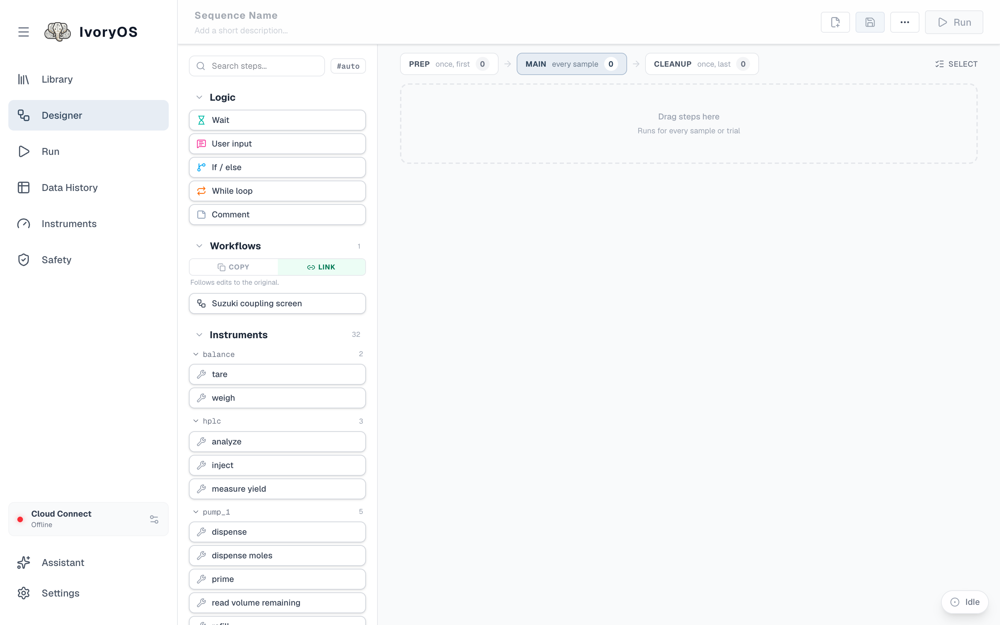
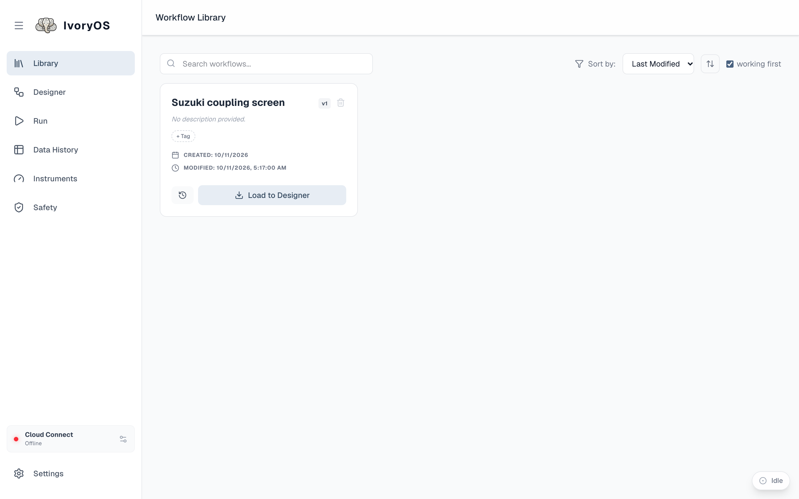
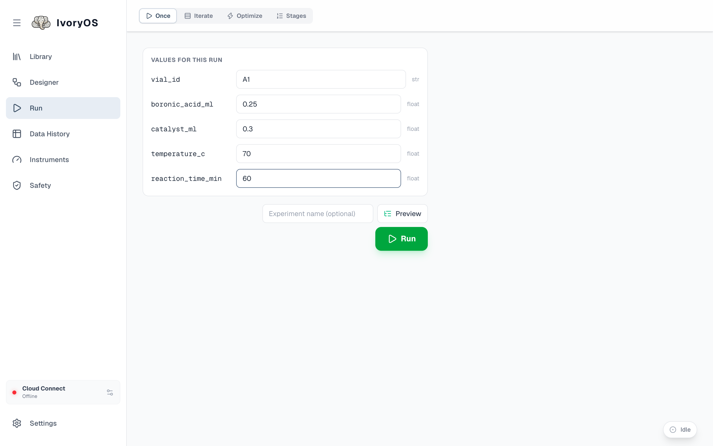

import { Steps, Aside } from '@astrojs/starlight/components';

The example deck is a simulated Suzuki coupling screen: three syringe pumps charge a vial, a
heater-stirrer holds it at temperature, and a UV-Vis probe and an HPLC read out how much product
formed. There is nothing to plug in, and the chemistry responds the way a real screen would: yield
depends on temperature, catalyst loading and reaction time, with a genuine optimum for the
optimizer to find. Simulated time is compressed, so a two-hour hold takes a couple of seconds.

## Start it

In the desktop app, choose **Try the example** on the welcome page (or **Add a deck → Try the
example** later). The app writes a short script and the example drivers into an `example` folder in
your home directory, starts it, and opens its page when it is ready.

From a source checkout, run it from a terminal instead and open `http://localhost:8080`:

```bash
python example/demo.py
```

Either way you land on the **Designer**, with the deck's instruments listed down the left as steps
you can drag.



## Load the ready-made workflow

<Steps>

1. Open **Library** in the sidebar. The example ships with one saved workflow, *Suzuki coupling
   screen*.

   

2. Click **Load to Designer**. The Designer opens with the workflow on its canvas: load a vial,
   dispense three reagents, stir, heat, hold, cool, then measure absorbance and yield.

   

3. Read the steps. Some values are typed in (`volume_ml=0.2`); others are written as a
   `#variable` (`setpoint_c=#temperature_c`). A `#variable` is a value left open, to be filled in
   when the workflow is run. The last two steps save what they measure (`→ absorbance_312`,
   `→ yield_percent`).

</Steps>

## Run it once

<Steps>

1. Click **Configure** at the top right (the button reads **Run** when a workflow has no open
   values). It opens the **Run** page on its **Once** tab, with one field per `#variable`.

   

2. Fill in a sample: `vial_id` A1, `boronic_acid_ml` 0.25, `catalyst_ml` 0.3, `temperature_c` 70,
   `reaction_time_min` 60. Give the run a name if you like; left blank, it is numbered.

3. Click **Preview** to see exactly what will run, step by step, then **Run**.

4. Watch the run bar at the bottom of the page: it names the step the deck is on, and opens to show
   every step with its result as it comes in. The whole run takes about ten seconds here.

   

</Steps>

## Read the result

Open **Data History**. The run is at the top of the list; select it to see every step, its
arguments and what it returned, and a timeline of how long each took. **Export Data** gives you a
CSV with one column per value you typed in and one per value a step saved.


## Where next

- [Iterate](/run/iterate/) runs the same workflow over a spreadsheet of samples.
- [Optimize](/run/optimize/) lets a Bayesian optimizer choose the temperature and catalyst loading
  for you. On the example deck, first add an optimizer under the deck's **Settings** in the desktop
  app.
- [The Designer](/guide/designer/) is where to change the workflow or build your own.

<Aside type="tip" title="Bring your own instruments">
When you are ready for real hardware, [Write a driver](/dev/instruments/write-a-driver/) shows what
IvoryOS reads from a Python class, and the desktop app's **Add a deck** installs drivers from the
Automation Hub or from your own package.
</Aside>
